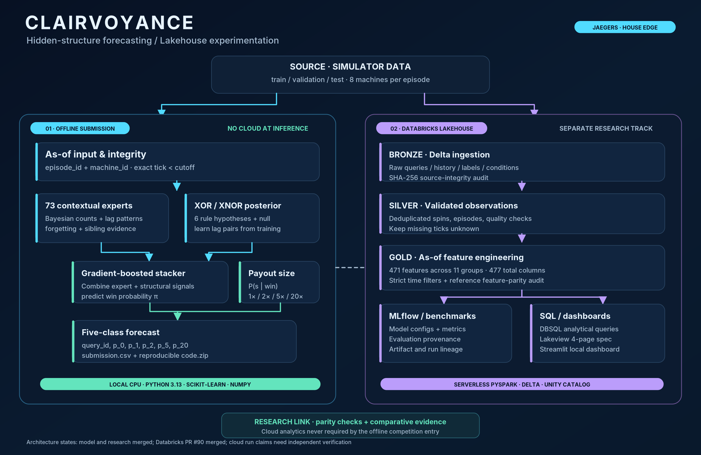

# JAEGERS — TAMU Datathon 2026

Probabilistic forecasting, experiment engineering, and research infrastructure developed for TAMU Datathon 2026. This public repository includes two distinct challenge areas:

## Featured project: Clairvoyance — See What Can't Be Seen

**Clairvoyance**, our House Edge entry, infers five-class slot-machine payout probabilities from sparse and changing histories. It combines **73 lag-context experts**, a Bayesian posterior over **XOR/XNOR lag rules**, and a **gradient-boosted stacker**, with conditional payout-size estimates.



**[Live Devpost entry](https://devpost.com/software/high-roller)** · **[Technical architecture](docs/architecture/CLAIRVOYANCE.md)** · **[Editable architecture SVG](docs/architecture/assets/clairvoyance_architecture_overview.svg)** · **[Databricks implementation](Jaeger_Main/House_Edge/databricks/README.md)**

| What we built | Evidence or capability |
| --- | --- |
| **Probabilistic inference** | Offline CPU predictor producing `p_0,p_1,p_2,p_5,p_20` from strictly earlier observed ticks |
| **Structure discovery** | Six XOR/XNOR lag-rule hypotheses plus null, combined with 73 contextual experts |
| **Main-round validation** | **55.485/60**, team-recorded *public validation*, not an official hidden score |
| **New-data evaluation** | **18.5/20**, team-reported *local checker scale*, not the organizer's 40-point adaptation allocation |
| **Databricks research infrastructure** | PySpark + Delta Bronze/Silver/Gold, Unity Catalog, **471 engineered features**, MLflow and SQL analytics; PR [#90](https://github.com/AsvM45/jaegers/pull/90) merged |
| **Reproducible research** | Grouped evaluations, experiment registry, statistical comparisons, CI and read-only Streamlit dashboard |

**Architecture boundary:** Databricks powers the separate data-engineering and experimentation lane; the competition predictor calls **no cloud service** at inference. Historical stacker pseudo-example as-of compliance remains **NOT_CERTIFIED**, and local scores are not official leaderboard results. The Databricks merge does not independently certify its reported live job runs, MLflow metrics, or Lakeview publication. See [scientific caveats](docs/science/EVALUATION_AND_PROVENANCE.md).


| Project | Source | Scope |
| --- | --- | --- |
| **House Edge** | [`Jaeger_Main/House_Edge/`](Jaeger_Main/House_Edge/) | Five-class payout-probability forecasting, reproducible statistical evaluation, offline release engineering, research experiments and monitoring |
| **Hack the Highway / Hitachi** | [`Jaeger_Main/Hitachi/`](Jaeger_Main/Hitachi/) | An independent challenge project. The full `tower/` implementation and adversarial tests currently live on the separate [`hitachi` branch](https://github.com/AsvM45/jaegers/tree/hitachi/Jaeger_Main/Hitachi) |

**Submission and evidence:** [Clairvoyance's Devpost entry](https://devpost.com/software/high-roller) is published with a recorded TAMU Datathon submission timestamp. The team reports separate House Edge form submission; the public repository does not contain its private receipt. The **55.485/60** result is main public *development validation*, and **18.5/20** is a team-reported *local new-data evaluation*, not the organizer's official 40-point adaptation result or a hidden leaderboard score. An earlier frozen Linux candidate has separate reproducibility evidence. Historical pseudo-training feature compliance remains **NOT_CERTIFIED**; see [current state](docs/CURRENT_STATE.md) and [architecture evidence](docs/architecture/CLAIRVOYANCE.md).

## Read first

For an up-to-date synthesized continuity source for new ChatGPT sessions, start at [the canonical JAEGERS project source](docs/JAEGERS_PROJECT_CONTEXT_2026-11-08.md). The complete Nov 7 Drive experiment-factory research has been reconciled into [current technical design](docs/research/EXPERIMENT_FACTORY_v7.md) and [plain-English guide](docs/research/EXPERIMENT_FACTORY_GUIDE.md); historical originals are archived separately, and private/personal materials are excluded. GitHub Wiki and Projects are enabled at the repository level but live publication/board configuration is not confirmed.


| Need | Canonical source |
| --- | --- |
| Current evidence, integrated work and unknowns | [Verified status](docs/CURRENT_STATE.md) and [issue #18](https://github.com/AsvM45/jaegers/issues/18) |
| Clairvoyance model, Databricks and architecture diagram | [Clairvoyance technical architecture](docs/architecture/CLAIRVOYANCE.md) |
| Monorepo architecture and source directories | [Architecture overview](docs/architecture/SYSTEM_OVERVIEW.md) |
| Evaluation, calibration and statistical pitfalls | [Scientific validation and provenance](docs/science/EVALUATION_AND_PROVENANCE.md) |
| Setup, offline tests, packaging and operations | [CI and release runbook](docs/runbooks/CI_AND_RELEASE.md) |
| AI agents, physical worktrees, GitHub Agents tab | [Agents and worktrees](docs/agents/GITHUB_AGENTS_AND_WORKTREES.md) |
| Contributor scope and pull-request checklist | [Contributing](CONTRIBUTING.md) and [governance runbook](docs/ops/PR_GOVERNANCE_RUNBOOK.md) |
| Security and responsible disclosure | [Security policy](SECURITY.md) |
| Long-form engineering design (historical snapshot) | [Engineering specification v5](docs/ENGINEERING_SPEC.md) |
| Platform decisions and optional GitHub features | [ADR-0001](docs/adr/0001-github-engineering-features.md) |
| Wiki-style navigation | [`docs/wiki/Home.md`](docs/wiki/Home.md) |

The definitive **task contract** lives in its GitHub issue; the definitive **code state** lives in its branch or merged commit. The dated documents are not proof that an agent is running. Check [Issues](https://github.com/AsvM45/jaegers/issues), [Pull requests](https://github.com/AsvM45/jaegers/pulls), and [Actions](https://github.com/AsvM45/jaegers/actions).

## Getting started locally

Read [`AGENT_START_HERE.md`](AGENT_START_HERE.md), root [`AGENTS.md`](AGENTS.md), and [House Edge `AGENTS.md`](Jaeger_Main/House_Edge/AGENTS.md) before any automated modification. Some older startup text is a historical handoff; the latest issue claim and current code supersede dated task assignments.

House Edge commands (from its directory, after Python 3.13 and dependencies are set up):

```bash
cd Jaeger_Main/House_Edge
python -m pip install -r requirements-research.txt
python -m pytest tests/test_release_smoke.py tests/test_temporal.py -q
python scripts/smoke_release.py --self-test
```

The repo-root component CI and experiment architecture are documented in [the runbook](docs/runbooks/CI_AND_RELEASE.md). The Hitachi branch has its own source and tests; do not assume those tests run on `main`.

## Collaboration and repository policy

Agents use **one claimed issue**, **one exclusive write scope**, **one branch**, and a **separate physical checkout or GitHub-hosted cloud sandbox**. All changes arrive through reviewable PRs. Claims, handoffs and limitations are recorded on the issue. GitHub's Agents tab manages GitHub-hosted Copilot/agent-app sessions; it does **not** monitor local Grok, Claude, Cursor or Antigravity processes.

**Public repository warning:** Do not commit organizer tokens, private receipts, hidden labels, credentials, private conversations, unpublished participant data, or generated run directories. Public visibility is not a software license; licensing remains a maintainer/coauthor decision.

_Source-of-truth policy: current code + official organizer kit + current issue/PR evidence > current docs > older handoffs and chat exports._
