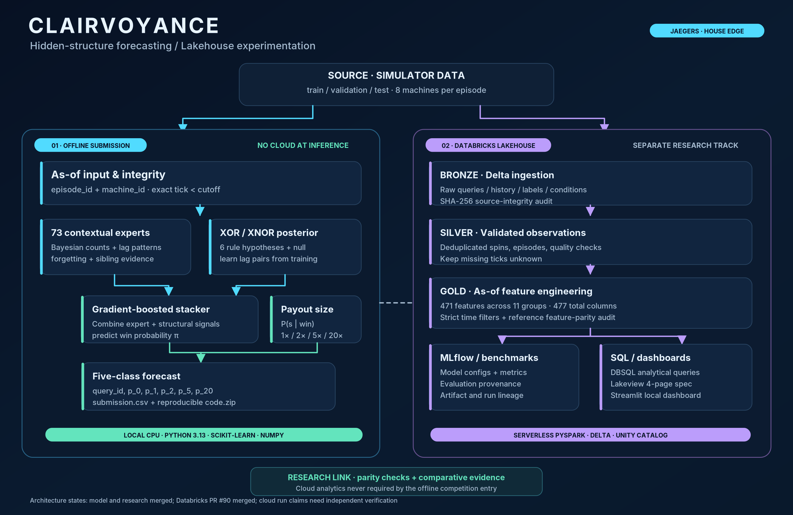

# Clairvoyance — public system architecture

**JAEGERS / TAMU Datathon 2026 · House Edge forecasting**

**[Live Devpost project](https://devpost.com/software/high-roller)** · [Repository home](../../README.md) · [Databricks code](../../Jaeger_Main/House_Edge/databricks/) · [Experiment & evaluation documentation](../science/EVALUATION_AND_PROVENANCE.md)

[Open full-resolution PNG](assets/clairvoyance_architecture_overview.png) · [View/edit SVG](assets/clairvoyance_architecture_overview.svg)

## Architecture at a glance

**Clairvoyance estimates the complete five-class distribution for the next payout**, not a single winning label. A query specifies an episode, one of its eight related machines, machine type, the currently observed signal and an exact prediction cutoff. The five outputs are

\`\`\`csv
query_id,p_0,p_1,p_2,p_5,p_20
\`\`\`

Every probability is finite and nonnegative; values sum to one. Input histories may be incomplete, and **an absent tick is not the same as a zero payout**. For a requested cutoff \`c\`, model features must use only observed payouts at ticks strictly less than \`c\`, including sibling machines.

**Two separated systems** share their public source data but not runtime dependencies:

| Lane | Purpose | Deployment/constraints |
| --- | --- | --- |
| **Offline competition model** | Fit probabilistic forecaster and generate complete test CSV | Python 3.13, NumPy, scikit-learn; offline CPU with no API, Databricks or internet calls |
| **Databricks lakehouse** | Ingest and validate data, build feature tables, evaluate research models, track evidence | Serverless PySpark, Delta Lake, Unity Catalog, SQL, MLflow; separate sponsor/research system |
| **Local research registry and dashboard** | Execute bounded experiments, preserve configurations/metrics, inspect comparisons | Python/pytest, grouped folds, versioned registry, read-only Streamlit dashboard |
| **Reproducibility/CI** | Verify file contracts, numerical output, claims and pull-request scope | GitHub Actions + pinned local Linux environment |

\`\`\`mermaid
flowchart TB
    A[Organizer public train / validation / test histories] --> B{Two independent paths}
    B --> C[Offline as-of history extraction]
    C --> D[73 lag-context experts]
    C --> E[XOR / XNOR rule posterior + null hypothesis]
    D --> F[HistGradientBoosting win stacker]
    E --> F
    C --> G[Conditional payout size experts]
    F --> H[Five-class probability forecast]
    G --> H
    H --> I[submission.csv + reproducible code ZIP]
    B --> J[Databricks Bronze: Delta raw ingest + SHA-256 audit]
    J --> K[Silver: validated episode observations]
    K --> L[Gold: 471 as-of engineered features]
    L --> M[MLflow and model comparisons]
    L --> N[Databricks SQL / Lakeview specification]
    M -. scientific parity and provenance .-> F
    N -. read-only analysis .-> O[Research dashboard]
\`\`\`

**No cloud calls are made by the offline competition entry.** The dashed links above denote development-time comparison/provenance, not live inference dependencies.

## Forecasting model

1. **73 contextual experts.** Each expert models a historical win/loss context, including single and paired lags, with decayed counts, smoothed priors and likelihood-weighted peer evidence within an episode. Their mixture produces an initial win probability.
2. **XOR/XNOR rule inference.** For a candidate pair \`(a,b)\`, compare the win/loss bits at ticks \`t-a\` and \`t-b\`. Agreement represents XNOR; disagreement represents XOR. The structural model maintains posterior weights over **six rule hypotheses plus a null fallback**, and lag pairs can be learned from the current round's permitted training histories.
3. **Gradient-boosted stacking.** A scikit-learn histogram gradient-boosting model combines the contextual mixture with four structural posterior features, producing the probability of any win, \`pi\`.
4. **Conditional payout size.** Separate positive-payout estimators yield \`q(s | win)\` for \`s = 1,2,5,20\`. The output is \`P(0)=1-pi\` and \`P(s)=pi*q(s|win)\`.

The main-round structural experiments identified candidate pairs \`(1,3)\`, \`(2,5)\`, \`(4,7)\`; later team research reported new pairs \`(3,8)\`, \`(1,4)\`, \`(2,6)\` from a changed training distribution. The mechanism's value was greatest in short-history conditions; drift remains a limitation.

**Critical information-set caveat:** a query-time prediction and an older synthetic training example are not automatically governed by the same available information. An independent historical-feature audit found look-ahead concerns in original pseudo-training rows. See [historical as-of witness](../release/GROK_HISTORICAL_FEATURE_COMPLIANCE.md) (**NOT_CERTIFIED**). No official compliance ruling is implied.

## Databricks implementation — distinct from inference

The lakehouse research stack lives in [\`Jaeger_Main/House_Edge/databricks/\`](../../Jaeger_Main/House_Edge/databricks/). **PR [#90](https://github.com/AsvM45/jaegers/pull/90) merged November 8, 2026**, adding the integrated cloud path. Git history verifies code integration, not the scientific correctness of every reported workspace outcome.

| Stage | Data/logic | What it enables |
| --- | --- | --- |
| **Bronze** | Raw queries, historical spins, labels, conditions and SHA-256 audit | Traceable source ingestion |
| **Silver** | Validated, deduplicated spins, episodes and queries; missing-tick semantics | Clean temporal datasets |
| **Gold** | **471 features across 11 groups**, computed with as-of filtering | ML comparisons and feature-parity auditing |
| **Parity** | Compare Spark/Delta features with a NumPy reference on permitted observations | Detect discrepancies in transformations |
| **MLflow** | Track model params, configurations, metrics, artifacts, hashes and evaluation provenance | Inspect comparable experiments |
| **Databricks SQL / dashboard spec** | Queries for leaderboard, calibration, drift, outliers and ingest audit; Lakeview spec | Research reporting, not offline inference |

The 471 features span **machine type (3), lags (48), lag pairs (280), rolling windows (18), decays (18), transitions (48), missingness (11), changes (7), peer context (11), type–lag interactions (24) and query signal (3)**. The reported Gold schema has **477 columns total** including six metadata fields.

**Evidence tiers:** A connected workspace metadata check observed **15 managed Delta tables and one view** in \`workspace.house_edge\` and the Gold column schema. The Databricks PR reports a successful six-task Serverless DAG and MLflow benchmarking. Those runtime/metric claims are **author-reported**, not independently reconciled here against row-level results or a published Lakeview dashboard. We do **not** equate sampled-label Brier with organizer true-vector validation.

## Experimentation, evaluation and test boundaries

- **Public true-vector validation** evaluates the organizer's actual probability-vector targets. It is development-exposed and repeated tuning may overfit it.
- **Training-only episode-grouped folds** compare models against observed outcomes using a distinct one-hot Brier target. These metrics cannot be numerically substituted for official validation points.
- **Registered experiments and paired bootstrap intervals** retain conditions, seeds, candidate families, ablations and failure evidence. Read-only [Streamlit dashboard](../../dashboard/) and the merged [HE-88 integration](https://github.com/AsvM45/jaegers/pull/92) expose comparisons.
- **Main local public validation:** Structural Stack **55.485/60**, earlier pinned champion **55.091/60**; these are documented team figures, **not hidden test scores**.
- **New-data evaluation:** **18.5/20**, team-reported on a **local 20-point reporting scale**. The released repository rules describe **40 official adaptation points** (a separate organizer guide describes an incompatible scale); no official 40-point equivalent is inferred.

The original frozen main CSV+ZIP was cold-reproduced twice on one Linux host using pinned NumPy/OpenBLAS CPU dispatch. This does not prove identical behavior on every possible CPU or that later submissions share the same hashes.

## Public release and status

[Clairvoyance's Devpost project](https://devpost.com/software/high-roller) is published and has a **recorded TAMU Datathon hackathon submission timestamp**. The user separately confirms a House Edge form submission, but this public repo does not publish private organizer receipts. Official judging/hidden scores are not established by these local measurements.

**Verified code path:** GitHub main includes the forecast research engine, expanded evaluation/CI, Streamlit quantitative dashboard, and merged Databricks integration. **Not claimed:** full historical as-of certification, independent verification of all live cloud job metrics, published Lakeview deployment, universally portable bit-for-bit reproduction, or an official winning/ranking result.

## Explore the source

- [Forecasting model and tests](../../Jaeger_Main/House_Edge/)
- [Research trial registry and models](../../Jaeger_Main/House_Edge/research/)
- [Databricks Medallion + MLflow implementation](../../Jaeger_Main/House_Edge/databricks/)
- [Streamlit dashboard](../../dashboard/)
- [Main CI workflows](../../.github/workflows/)
- [Scientific validation & provenance](../science/EVALUATION_AND_PROVENANCE.md)
- [Architecture overview of the complete monorepo](SYSTEM_OVERVIEW.md)
- [Public Devpost submission](https://devpost.com/software/high-roller)

*Architecture updated Nov 8, 2026. Data and score claims are labeled by their source and level of verification.*
