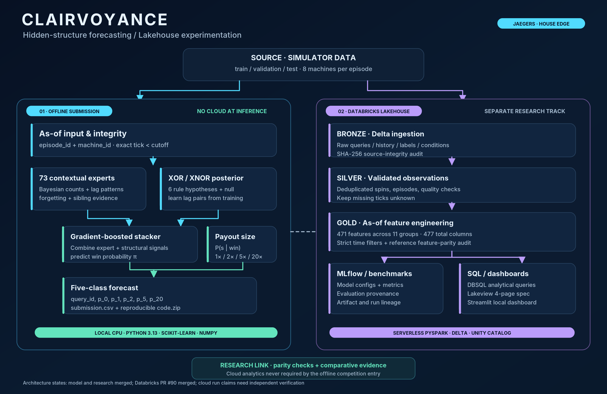
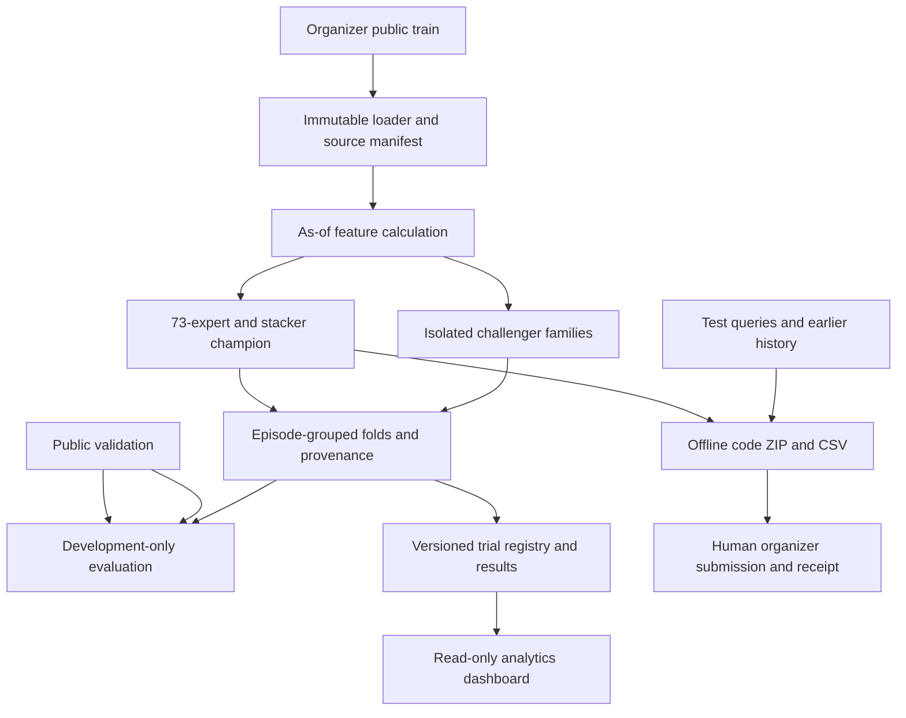

# Architecture — JAEGERS

**Verification anchor:** source tree and merged commit `9eec670c8bd3b1fcdcc67f7d376cbf316dd639a8`, Nov 8 2026. Modules evolve; verify imports and interfaces before implementation. See [current state](../CURRENT_STATE.md) and [House Edge contracts](../../Jaeger_Main/House_Edge/research/CONTRACTS.md).


> **Post-submission architecture addendum (Nov 8, 2026):** The visitor-facing [Clairvoyance architecture](CLAIRVOYANCE.md) contains the current model diagram, Databricks Medallion workflow, experiment components, score provenance, and public Devpost link. The source-specific verification anchor below is an older snapshot; **Databricks PR #90 has now merged**, whereas cloud job outcomes reported in that PR are not thereby independently verified. The team's new-data **18.5/20** is on a local reporting scale, not the official 40-point round allocation. Historical stacker pseudo-training as-of compliance remains **NOT_CERTIFIED**.



## Monorepo boundaries

```text
Jaeger_Main/
  House_Edge/
    public/                  organizer-released inputs; only licensed/public-safe data
    jaegers_entry/           protected champion predictor and parameters
    research/                episode-grouped evaluation, model adapters,
                             feature API, challengers, registry and trial reports
    adaptation/              distinct round-two orchestration and blocker report
    scripts/                 smoke and reproduction helpers
    tools/                   packaging/environment verification
    dashboard/               read-only analysis of versioned registry results
    databricks/              sponsor-specific ETL / feature parity / MLflow bundle
    tests/                   cutoff, release, adversarial and component tests
  Hitachi/
    Data/                    challenge input package and enterprise source
    enterprise.py
    enterprise_server.py
    # expanded tower/ architecture is on the separate 'hitachi' branch
docs/                        canonical source-backed project knowledge
.github/workflows/            pull-request gate and bounded component CI
tools/                        root repository governance and audit scripts
```

The House Edge inference runtime is **offline CPU Python**, separate from research orchestration and any optional cloud sponsors. The GitHub repository is public; personal organizer tokens, receipts, private resources and Git-ignored experiment outputs do not belong in its history.

## House Edge learning and inference



**Statistical target:** one five-class probability vector `[p_0,p_1,p_2,p_5,p_20]` per query, where output values are finite/nonnegative and sum to 1. There are eight related machines per episode, and only history with `tick < cutoff` may enter a prediction, including sibling machines. Machine identities and absolute tick values do not persist across episodes. Missing history ticks are *missing*, not 0× payouts.

**Model implementation:** `jaegers_entry/` is a protected frozen champion. `research/adapters.py`, `research/feature_api.py`, `research/dataset.py`, `research/metrics.py`, `research/worker.py`, `research/registry.py` and `research/challengers/` provide evaluation tooling and experimental models. Use actual [integration contracts](../../Jaeger_Main/House_Edge/research/CONTRACTS.md) before touching interfaces; it is not safe to extrapolate signatures from old examples.

**Scientific limitations:** Real next-spin probability targets are public in validation but hidden in test, so *public scores are repeatedly development-exposed*. An independent historical-feature witness identified post-t dependence in pseudo-training rows; see [the `NOT_CERTIFIED` report](../release/GROK_HISTORICAL_FEATURE_COMPLIANCE.md). Do not call this hidden-test leakage or assert organizer legality without a ruling.

## Release and adaptation isolation

The main candidate is a **paired** `submission.csv` and `code.zip`, locally Git-ignored with hashes recorded in [CURRENT_STATE](../CURRENT_STATE.md). The organizer sandbox is CPU/offline; cold reproduction must use the matching runtime and numerical tolerance. Never mix a Windows CSV with a Linux ZIP merely because the Python source matches: CPU dispatch differences were measured.

Round-two adaptation uses the **different** data kit, season metadata and query IDs. Its `adaptation/run_adaptation.py` rejects main-round metadata. The merged [adaptation status](../../Jaeger_Main/House_Edge/adaptation/RELEASE_STATUS.md) says `BLOCKED_KIT_MISSING`, with no independently verified adaptation submission.

## Sponsors and visibility boundaries

The `databricks/` subtree now includes the merged [PR #90](https://github.com/AsvM45/jaegers/pull/90) Serverless execution, Delta Medallion, 471-feature Gold, parity and MLflow implementation. The reported six-task job and MLflow run evidence are **PR-author reports**; merge/CI do not independently establish numeric data parity, authentic job outcomes, MLflow metric validity or published Lakeview deployment. The `dashboard/` package reads exported trial records without rewriting them. The Hitachi `tower/` component remains an independent challenge area.

## Operational ownership

One issue per agent, explicit claim, exclusive writable paths, own physical checkout/cloud sandbox, and independent PR review. [Governance runbook](../ops/PR_GOVERNANCE_RUNBOOK.md) and [agent guide](../agents/GITHUB_AGENTS_AND_WORKTREES.md) document the execution contract. GitHub Actions verifies some conditions; no automation proves local process ownership or an organizer receipt.


## Warehouse and universal experimentation: reconciled design (Nov 8)

The complete Nov 7 v7 design and plain-English Drive source were reconciled into the current [experiment-factory technical specification](../research/EXPERIMENT_FACTORY_v7.md) and [human guide](../research/EXPERIMENT_FACTORY_GUIDE.md). Their immutable source texts are retained as historical design evidence in [Drive research origins](../archive/drive/README.md); separate personal educational material is excluded.

**Implemented in main** (inspect code and checks): Python loaders, as-of/episode-grouped feature and evaluation contracts, the local trial registry/worker tooling, challengers, an offline Databricks mock pipeline/SQL and MLflow logging adapters, read-only dashboard, and several path-scoped Actions checks. **Not fully independently certified:** a generalized condition-constraint compiler for every model family, durable multi-host leasing or budget scheduler, author-reported live Spark/MLflow job outcomes, a published Lakeview dashboard, and private organizer submission receipts. Databricks cloud implementation has merged; that is not a scientific provenance audit.

The source design separates **data durability** (immutable CSV/Parquet/Delta source + lineage), **trial scheduling** (atomic unique trial IDs, claims/leases, retries, budgets), **scientific evaluation** (episode-grouped and cutoff-safe metrics), and **presentation** (read-only dashboard/MLflow views). This separation is architectural, not evidence each component is production ready.

Independent workspace metadata checks observed 15 managed Delta tables and one view in `workspace.house_edge`, including a Gold schema with 477 columns (6 metadata + 471 engineered features). This does not itself verify row-level integrity, final scientific metrics or a published Lakeview dashboard. Issue [#14](https://github.com/AsvM45/jaegers/issues/14) and merged [PR #90](https://github.com/AsvM45/jaegers/pull/90) contain the evolving evidence. Main inference must run offline independent of Databricks. 
